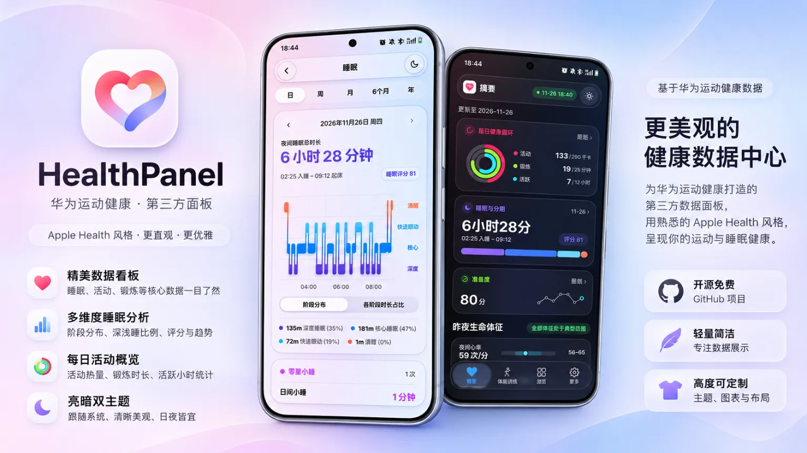

<div align="center">
  
  <h1>Health Panel</h1>
  <p>离线隐私优先的华为运动健康 Android 本地面板（Apple Health / ColorOS 风格容器动效与 Liquid Glass UI）+ 内置本机只读 MCP Server。</p>
  <p>
    <a href="LICENSE"></a>
    <a href="#环境要求"></a>
    <a href="https://github.com/CCCche/huawei-health-panel/releases/tag/v1.0.2"></a>
  </p>
</div>

<p align="center">
  
</p>

---

## 核心特性

### 1. 全本地离线健康面板（`:panel`）
- **无需云端、无需上传健康数据**：直接在手机本地读取华为运动健康数据库（`hihealth_003.db`），结合 Chaquopy 内嵌 Python 3.12 分析引擎与本地 SQLite（`panel.sqlite`）完成汇总、指标计算与图表渲染。
- **Root 自动恢复密钥 + 纯本地 SQLCipher 4 解密**：支持从本机运行中的华为健康守护进程内存恢复 SQLCipher 4 原始密钥（或使用手动导入的加密/明文数据库备份），通过 OpenSSL / Java `javax.crypto` 完成页级 HMAC-SHA512 校验与 AES-256-CBC 解密。
- **多维度健康看板与 Pro Insights**：
  - **摘要（Summary）**：今日活动三环、训练准备度（Readiness）、昨夜睡眠、静息心率、HRV、血氧、呼吸频率、皮肤温度与重点趋势卡片。
  - **训练（Workouts）**：按运动类型/时间检索记录、训练分段（Splits）、心率区间分布、跑姿指标与地图轨迹查看（支持高德 / Esri 瓦片白名单策略）。
  - **科学睡眠与小睡 / 心电图（ECG）**：夜间睡眠分期结构、小睡汇总、ECG 心电记录与波形查看（支持拖动隐藏游标、点按显示读数），以及本地单导联波形节律识别算法（窦性心律/心动过缓/心动过速/心律不齐/疑似房早室早/疑似房颤与信号质量评估）。
  - **深度洞察（Pro Insights）**：急性/慢性训练负荷比（ACWR）、睡眠与生理指标相关性分析、有氧效率趋势等。
  - **JSON 导出**：支持将当前本地汇总数据导出查看或备份。
- **Liquid Glass 视觉与 ColorOS 风格容器变换动效**：
  - 首页卡片点击展开 / 收起采用基于几何测量的容器变换过渡（Container Transform），平滑对齐源卡片与详情浮层。
  - 支持底栏胶囊拖拽切换与点按直达（`v1.0.0` 已修复紧凑态底栏首次点击位移及卡片收起尾段吞事件导致的“连点两下才切页”问题）。

### 2. 内置本机只读 MCP Server（`PanelMcpService`）
- `:panel` 内置轻量级 HTTP JSON-RPC 2.0 MCP 服务（默认监听 **`127.0.0.1:18765/mcp`**，可在应用内切换开关、端口、Bearer Token 或局域网绑定）。
- **纵深安全边界**：
  - 默认仅绑定回环地址 `127.0.0.1`，强制校验随机生成的 256-bit `Bearer Token`、严格校验 `Host` 头与 `Content-Length`（1B ~ 64KB）、拒绝携带 `Origin` 头的浏览器跨域请求。
  - 全部工具标注 `readOnlyHint: true`、`openWorldHint: false`，底层 SQLite 以只读模式打开，不暴露写入、Shell 执行或导出敏感文件能力。
  - 支持 MCP 协议版本：`2025-11-25`、`2025-06-18`、`2025-03-26`。
- **内置 MCP 资源与工具（9 个只读工具 + 1 个摘要资源）**：
  - Resource：`health://overview`（`application/json`）
  - `get_health_overview`：近期健康指标、昨夜体征与训练准备度
  - `get_daily_summary`：按日期区间与字段筛选每日健康摘要
  - `get_day_detail`：单日睡眠、体征及训练详情
  - `get_metric_detail`：各指标的日 / 周 / 月 / 半年 / 年（`D`/`W`/`M`/`6M`/`Y`）统计
  - `list_workouts`：按运动类型、日期范围与数量上限筛选训练记录
  - `get_workout_detail`：单次训练分段、心率区间及跑姿（GPS 等轨迹序列默认折叠，可通过 `include_series: true` 显式获取）
  - `get_sleep_sessions`：科学睡眠分期与小睡记录
  - `get_ecg_records`：心电图记录状态及可选波形数据
  - `get_pro_insights`：训练负荷、睡眠关联与有氧效率分析

### 3. 配套独立解密工具与工程模块
- [`decrypt_db.py`](decrypt_db.py)：独立 Python CLI 工具，支持通过 OpenSSL `libcrypto`（`ctypes`）离线解密华为运动健康 `hihealth_003.db`（SQLCipher 4：`PBKDF2-HMAC-SHA512`、`page_size=4096`、`reserve=80`），并可选 `--recover-key` 与 `--verify-all-hmac`。
- [`android-app/panel`](android-app/panel)：核心主面板 APK（Kotlin + Chaquopy Python 3.12 + WebView + MCP Server），`v1.0.2`（`versionCode = 24`）。
- [`android-app/offline`](android-app/offline)：轻量原生离线壳模块（Jetpack Compose + COUI-Kit + C 原生密钥恢复助推器）。
- [`android-app/app`](android-app/app)：早期示例容器模块（已脱敏，域名与路径均为示例占位）。

---

## 仓库结构

```text
.
├── README.md
├── LICENSE                          # MIT License
├── .gitignore
├── decrypt_db.py                    # 独立 SQLCipher 4.9.0 离线解密与密钥恢复脚本
├── docs/
│   ├── assets/
│   │   ├── icon.png                 # 应用图标
│   │   └── preview.webp             # README 功能概览介绍图
│   └── PROJECT_UPDATE_PLAN.md       # 功能迭代与架构演进记录
└── android-app/
    ├── README.md                    # Android 工程说明与测试命令
    ├── settings.gradle.kts
    ├── build.gradle / gradle*
    ├── panel/                       # 核心离线健康面板 + 本地 MCP 服务 (:panel)
    │   ├── build.gradle.kts
    │   └── src/
    │       ├── main/
    │       │   ├── assets/          # Web UI (index.html, app.js, style.css, Liquid Glass, Leaflet)
    │       │   ├── java/xyz/orachen/health/panel/
    │       │   └── python/          # dashboard_api.py, db.py, ecg.py, health_import.py, local_panel.py, mcp_tools.py
    │       └── test/                # Kotlin 单元测试 & Python 合成数据单元测试
    ├── offline/                     # Compose + COUI-Kit 原生离线实验模块 (:offline)
    └── app/                         # 示例壳工程 (:app，已脱敏占位)
```

---

## 环境要求

- **安装使用 APK**：
  - Android 12+（`minSdk = 31`，仅打包 `arm64-v8a`）
  - 如需直接从手机本机自动读取/解密华为运动健康数据库，需要已获取 **Root 权限**；无 Root 时也可在界面中手动导入已导出的明文或加密数据库文件。
- **从源码编译 / 运行测试**：
  - Android SDK（`compileSdk 37` / `targetSdk 36`）、Android NDK（供 `:offline` 原生模块）与 JDK 17+
  - Python 3.12+（用于运行面板 Python 单元测试或 `decrypt_db.py`）
  - Node.js（可选，用于 `app.js` 语法检查）

---

## 快速开始

### 方式一：直接安装 Release APK（推荐）
1. 前往 [Releases v1.0.2](https://github.com/CCCche/huawei-health-panel/releases/tag/v1.0.2) 下载 `health-panel-v1.0.2-vc24.apk`。
2. 在手机安装后打开 **Health Panel**：
   - 若设备已 Root 且安装有华为运动健康，点击同步即可自动定位/恢复密钥并解密导入 `hihealth_003.db`；
   - 或手动选择本地数据库副本进行导入分析。
3. 如需接入 AI 客户端，可在面板内开启 **MCP Server**：
   - Endpoint：`http://127.0.0.1:18765/mcp`
   - Header：`Authorization: Bearer <面板生成的Token>`
   - 支持所有兼容 Streamable HTTP JSON-RPC 2.0 的只读 MCP 客户端（例如本机 Termux / Linux chroot 中的 CLI Agent）。

示例 `curl` 握手测试：
```bash
curl -sS -X POST http://127.0.0.1:18765/mcp \
  -H 'Content-Type: application/json' \
  -H 'Authorization: Bearer YOUR_TOKEN' \
  -d '{"jsonrpc":"2.0","id":1,"method":"tools/list"}'
```

### 方式二：离线使用 `decrypt_db.py` 解密数据库备份
```bash
python3 decrypt_db.py \
  --src /path/to/hihealth_003.db \
  --dst /path/to/hihealth_plain.sqlite \
  --key-hex <64-char-hex-key> \
  --verify-all-hmac
```
若需在本机 Root 环境下从守护进程恢复密钥：
```bash
python3 decrypt_db.py \
  --src /path/to/hihealth_003.db \
  --dst /path/to/hihealth_plain.sqlite \
  --recover-key
```

---

## 构建与测试

在仓库根目录执行：

```bash
# 1. 前端脚本语法检查
node --check android-app/panel/src/main/assets/static/app.js

# 2. Python 分析、睡眠/ECG 导入与只读 MCP 适配器单元测试
PYTHONPATH=android-app/panel/src/main/python \
  python3 -m unittest discover -s android-app/panel/src/test/python -v

# 3. Android 单元测试与调试包构建
cd android-app
./gradlew :panel:testDebugUnitTest :offline:testDebugUnitTest :panel:assembleDebug
```
构建产物位于 `android-app/panel/build/outputs/apk/debug/panel-debug.apk`。

---

## 隐私与安全声明

- 本仓库**不包含**任何个人健康数据库、同步凭据、SQLCipher 密钥、真实个人域名或私人环境脚本（`.gitignore` 默认排除 `config.json`、`.state/`、`.staging/`、`*.db`、`*.sqlite`、`*.apk` 等）。
- 数据全程在用户本地设备或离线环境解析；地图轨迹视图默认仅对显式放行的公开瓦片域名（高德 `autonavi.com` / Esri `arcgisonline.com`）开放请求。
- 使用 Root 自动提权恢复本机数据库密钥时，请仅在个人可控设备上运行并妥善保管导出的明文 SQLite 与 MCP Bearer Token。

---

## 致谢与开源引用（Credits & References）

本项目在实现过程中参考并使用了以下开源项目、库、协议规范与设计灵感（具体许可请以对应文件与上游仓库为准）：

| 项目 / 库 / 规范 | 用途说明 | 协议 / 来源 |
| :--- | :--- | :--- |
| **Liquid Glass UI** | 仪表盘玻璃拟态卡片、触控高光与底栏视觉基础样式（`dashboard-glass.js` / `.css`） | MIT License（见 `android-app/panel/src/main/assets/static/dashboard-glass-LICENSE.txt`） |
| **React & React DOM (19.2.0)** | 内嵌于 `dashboard-glass.js` 的 UI 渲染运行时 | MIT License |
| **Leaflet (1.9.4)** | 运动记录路线地图与轨迹图层渲染（`vendor/leaflet.*`） | BSD-2-Clause License（[leafletjs.com](https://leafletjs.com/)，`vendor/Leaflet-LICENSE.txt`） |
| **Chaquopy (17.2.0)** | Android APK 内嵌 Python 3.12 运行时（`:panel`） | Chaquopy License（`com.chaquo.python`） |
| **COUI-Kit (`0.0.1-alpha17`)** | ColorOS 风格 Compose 组件库（用于 `:offline` 与 `:app`） | MPL-2.0（[ItosEO/COUI-Kit](https://github.com/ItosEO/COUI-Kit)） |
| **AndroidX Activity / Jetpack Compose Material 3** | Android 导航、边到边适配与原生 UI 容器 | Apache-2.0 |
| **Model Context Protocol (MCP)** | 本地只读 JSON-RPC 2.0 Tool / Resource 协议适配（`2025-11-25` / `2025-06-18` / `2025-03-26`） | MCP Specification |
| **SQLCipher 4 & OpenSSL (`libcrypto`)** | `PBKDF2-HMAC-SHA512` / `AES-256-CBC` / `HMAC-SHA512` 离线页级校验与解密规范 | BSD-style / Apache-2.0 |
| **AutoNavi（高德地图） & Esri ArcGIS** | 运动轨迹公开 HTTPS 地图瓦片服务（经域白名单严格限制） | 第三方公开瓦片服务条款 |
| **Huawei HMS Health Kit / Apple Health / ColorOS** | 部分数据点常量规范参考（如体温点 `2104` / ECG 字段），以及健康卡片排版与物理容器变换（Container Transform）动效设计灵感 | 文档 / 视觉与交互设计参考 |

---

## 更新日志

### `v1.0.2`（`versionCode = 24`）
- **应用品牌与图标焕新**：桌面应用名称统一改为 **`Health Panel`**，启用全新渐变圆角矩形自适应图标（`@mipmap/ic_launcher` / `@mipmap/ic_launcher_round`）及对应内嵌应用图标 `icon.png`。
- **心电图本地波形节律识别算法**：在 ECG 详情页新增独立「波形算法识别」卡片（Python 后端 + JS 示例波形分析），支持识别窦性心律、窦性心动过缓、窦性心动过速、窦性心律不齐、疑似房性/室性早搏、疑似心房颤动及信号质量评估。
- **心电图交互逻辑重构**：横向拖动/缩放波形时自动隐藏选中竖线并实时展示可见时间窗，单击波形时精确显示选中竖线与 `s · mV` 读数；解除心电图区域的横向双滚动冲突。
- **卡片开合动效全链路帧率优化**：容器变换改由 Web Animations API（合成器线程）驱动、记忆化 React 玻璃卡片挂载并延迟非过渡期 SVG 位移贴图重建、移除全局通配 CSS 选择器并将 WebView 底色调整为不透明主题色，显著减少掉帧。

### `v1.0.0`（`versionCode = 22`）
- 首次公开发布 `:panel` 稳定版 `v1.0.0`。
- 修复底部导航栏在紧凑态按下触发位移及卡片收起动画尾段吞事件导致偶发需要“点两下才切页”的问题，实现单击直达与横向拖拽平滑跟手。
- 修复列表滚动期间的手势监听作用域回归，稳定 ColorOS 风格卡片打开/关闭容器变换动画，消除元素闪烁与快速位移问题。
- 完成敏感配置隔离与仓库示例路径/域名脱敏。
