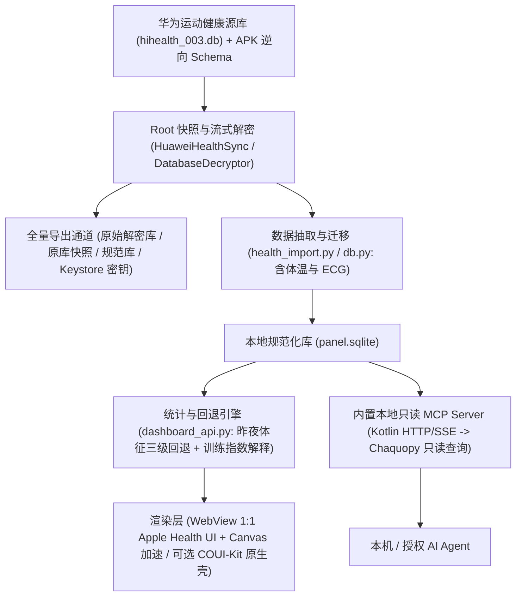

# `huawei-health-mcp` 离线健康面板后续更新规划文档

> **适用模块**：`android-app/panel`（包名 `xyz.orachen.health.panel`）
> **当前基线**：`v0.8.0`（`versionCode = 4`）
> **文档性质**：产品与技术架构设计规范（供评审拍板与后续分期开发使用）
> **目标版本规划**：`v0.9.0` → `v0.9.5` → `v1.0.0`

---

## 0. 背景与整体架构规划

截至 `v0.8.0`，`panel` 模块已完成 Root 自动读取 `hihealth_003.db` 快照与内存密钥恢复、SQLCipher 4 本地流式解密、增量解析入库、`AndroidKeyStore` 安全缓存、全屏沉浸式状态栏/手势条、长下拉增量刷新、首次使用指南、原生硬件触感振动（`VibratorManager`）以及高德/ArcGIS 在线地图底图集成。

本次规划将下一阶段需求梳理为三大主线：**基础数据补全（体温 + 心电图）**、**核心功能更新（5 项）**、**界面与图形性能更新（3 项）**。整体数据流与系统边界规划如下：



---

## 一、基础数据补全（体温 & 心电图）

### 1.1 现状与限制分析

- **现有存储与抽取范围**：
  - `android-app/panel/src/main/python/db.py` 当前包含 6 张表：`daily_summary`、`sleep_sessions`、`vitals_points`、`workouts`、`devices`、`sync_meta`。
  - `android-app/panel/src/main/python/health_import.py` 当前仅抽取 `SPH_METRICS`（心率 `2002`、静息心率 `2105`、血氧 `2103`、PPG 房颤提醒 `2200`、OSA `500002847`、情绪 `500031195/347/842`、HRV `500044831`）、压力（`2034`）以及小时汇总步数/卡路里/中高强度（`2/4/7`），`daily_summary` 与 `vitals_points` 尚无 **体温/腕温** 字段，也无 **心电图（ECG）波形与结论表**。
- **设备侧客观约束**：
  - 当前测试与自用设备为 **华为 Watch Fit 4（华为飞四）**，该设备无体温传感器与 ECG 电极硬件，本机 `hihealth_003.db` 中可能完全没有相关真实样本行，或仅存在空表/零星占位定义。

### 1.2 华为运动健康数据结构逆向与验证方案

由于本机手表无法产生真实体温与 ECG 样本，必须先通过逆向工程与 Schema 核验确定准确存储协议后再编码，**严禁猜测 `type_id` 或波形解码公式**。

1. **静态逆向与本地库结构排查流程（需用户授权后执行）**
   - 导出手机已安装的 `com.huawei.health` APK 及其分包（Split APKs），使用 `jadx` 反编译检索以下核心类与常量表：
     - `HiHealthDataType` / `HiHealthPointType` / `HiHealthSequenceType` / `HiHealthStatType`（获取皮肤温度、腕温、体温 `type_id` 与 `stat_type`，以及 ECG 记录 `type_id` / `sub_type_id`）。
     - ECG 解析与展示相关类（确认波形字节数组在 `sample_sequence.data` 或 `sample_sequence.meta_data` 中的存储结构、GZIP/Protobuf/FloatArray 编码方式、采样率 `Hz`、毫伏换算比例系数 `gain/LSB`、心律分类枚举码如窦性心律/房颤/过缓/过速/无法判断）。
     - 睡眠基线 JSON（`sleep_sessions.baselines_json` 对应的 `BASELINE_KEYS` 中是否含皮肤温度基线/腕温偏差键名）。
   - 直接检查已解密的全量 `hihealth_003.db` 的 `sqlite_master`，核对所有 `sample_*`、`hihealth_*` 表的建表语句及全量 `type_id` / `stat_type` 分布。
2. **无真实硬件样本下的工程测试策略**
   - 结合 **HMS Health Kit** 公开类型文档与逆向确认的内部结构，在单测夹具中编写 **合成原始快照生成器**：
     - 体温样本：包含连续皮肤温度、手腕温度基线偏移、主动单次体温测量（含正常 `36.3–37.0°C` 与发热/低温异常点）。
     - ECG 样本：包含 30s × 500Hz（约 15,000 点）标准 P-QRS-T 合成导联波形与多种心律分类记录，覆盖 `health_import.py` 解码、数据库落库、API 返回与前端高精度渲染全链路测试。

### 1.3 本地数据库 Schema 扩展（`db.py` & `health_import.py`）

1. **`daily_summary` 扩展列**（通过 `_migrate_schema()` `ALTER TABLE` 无损迁移旧库）：
   - `temp_min REAL`、`temp_avg REAL`、`temp_max REAL`、`temp_last REAL`（主动体温/皮肤温度日统计，`°C`）
   - `skin_temp_baseline_delta REAL`（夜间手腕温度相对个人基线偏差，`°C`）
2. **`vitals_points` 新增指标类型**：
   - `metric = 'body_temperature'`（单位 `°C`）
   - `metric = 'skin_temperature'`（单位 `°C`）
3. **新增表 `ecg_records`**：
   - 主键与时间：`start_ms INTEGER PRIMARY KEY`、`end_ms INTEGER NOT NULL`、`date TEXT NOT NULL`、`start_iso TEXT NOT NULL`
   - 诊断与参数：`classification TEXT NOT NULL`、`classification_code INTEGER`、`avg_hr REAL`、`sample_rate_hz REAL`、`duration_s REAL`、`lead_count INTEGER DEFAULT 1`
   - 症状与扩展：`symptoms_json TEXT`、`meta_json TEXT`、`device_name TEXT`
   - 波形二进制：`waveform_gz BLOB`（gzip 压缩后的 `float32` / 增量编码 mV 序列，保证单条 30s 记录 < 30KB）
   - 更新时间戳：`updated_at_ms INTEGER NOT NULL`，建索引 `idx_ecg_date ON ecg_records(date)`

### 1.4 Apple Health 1:1 界面复刻规范

- **视觉前置步骤（先找参考图再开发）**：
  - 开发前先收集并归档 **iOS 18 / iOS 26 Apple Health 原生「手腕温度 / 体温」与「心电图 (ECG)」官方界面截图**（含浅色模式与深色模式、列表页、详情页、无数据引导态），1:1 对照字号层级、色板、坐标网格比例与图标语义。
- **体温 / 手腕温度面板**：
  - 支持 `D / W / M / 6M / Y` 视图与滑动游标读数 + 触感反馈：
    - 夜间腕温模式展示 **相对个人基线偏差（`+0.3°C` / `-0.2°C`）** 与零基准虚线/典型波动带；
    - 主动体温模式展示标准区间（`35.5–37.5°C` 网格）与每次测量点详情。
  - 在「浏览 → 生命体征 / 身体测量」中新增入口；当有夜间温度数据时联动展示到「昨夜生命体征」中。
- **心电图（ECG）面板**：
  - **记录列表页**：按月份分组显示每次 30 秒测量时间、心律分类彩色徽章（窦性心律 / 房颤 / 高低心率 / 不确定）、平均心率（bpm）与缩略迷你波形条。
  - **单次波形详情页（1:1 医疗心电图纸）**：
    - 使用 **25 mm/s（水平：大格 `0.2s` / 5 小格每小格 `0.04s`）、10 mm/mV（垂直：大格 `0.5mV` / 5 小格每小格 `0.1mV`）** 标准红/粉网格背景（浅色柔和粉红格，OLED 深色低对比暗红格）；
    - 使用高 DPI `<canvas>` 绘制整段 30 秒可流畅横向拖动查看、双指/按钮倍率缩放的 I 导联心电波形，顶部实时显示当前时刻与电压指针；
    - 下方展示系统分析结果说明卡片、症状标签、平均心率、记录设备型号及导出波形报告（PDF / PNG / CSV）按钮。
  - **无硬件空态体验**：若本机无 ECG 数据（如华为 Watch Fit 4），展示精致的 Apple Health 风格说明卡与常见心律示例解释，并可提供显式标注为“示例数据预览”的查看开关，避免与真实数据混淆。

---

## 二、功能更新

### 2.1 心率图表增加按钮切换折线视图，心电图入口置于心率图表下方

- **涉及文件**：`panel/src/main/assets/static/app.js`、`style.css`、`dashboard_api.py`
- **心率图表视图切换**：
  - 在 `METRIC_META.heart_rate` 详情页（`drawDetailSvgChart`）图表卡右上角/顶部工具栏增加液态玻璃分段切换控件：`范围胶囊`（默认原有 min–max 胶囊柱 + 静息白点） ↔ `折线视图`（切换偏好写入 `localStorage`）：
    - **`W / M / 6M / Y` 维度折线视图**：主折线绘制日均值（或连续均值曲线），辅以半透明 min–max 上下包络阴影带与静息心率虚线参考线，保留拖动游标与 `triggerHapticTick(8)` 原生触感。
    - **`D` 单日维度**：支持按时间轴绘制高密度连续心率平滑折线 + 运动时段高亮叠加，若某时段无采样自动断开连线而不误连成直线。
- **心电图页面挂载在心率图表下方**：
  - 在心率详情页主图表与统计摘要卡紧下方新增 Apple Health 风格 **「心电图 (ECG)」板块卡**：
    - 有记录时：直接展示最近一次 ECG 的迷你波形预览、分类结论（如“窦性心律 · 72 次/分”）、测量时间及「所有心电图记录 ›」按钮，点击即可压栈进入完整 ECG 列表/波形详情页；
    - 无记录时：展示紧凑型「心电图（未检测到支持 ECG 的设备记录）」提示卡，支持点开了解结构说明或查看示例波形。
  - 同时在「浏览 → 心脏」分类下保留心电图直接入口，与心率详情内入口共享同一套视图栈。

### 2.2 设置界面新增导出全量数据库和解密密钥功能

- **设计核心**：用户本机 Watch Fit 4 无法采样的字段，在其他设备同步账号后仍保存在华为运动健康全量原始库 `hihealth_003.db` 中。**导出功能不能仅限于已被 `health_import.py` 裁剪过的 `panel.sqlite`**，必须优先支持导出 **未经裁剪的完整华为运动健康原始 SQLite**。
- **涉及文件**：`PanelActivity.kt`、`PanelSyncManager.kt`、`HuaweiHealthSync.kt`、`KeyCache.kt`、`index.html`、`app.js`
- **「更多 → 数据与密钥导出」功能清单**：
  1. **导出已解密全量原始数据库（主推荐）**：通过 `su -M` 拉取最新 `hihealth_003.db` 快照 → 使用缓存（或现场恢复）的 64 位密钥本地流式解密 → 调用 `normalizeSqliteHeader` 将第 18/19 字节 WAL 标记转为标准 `DELETE` 模式确保桌面 DB Browser / Python `sqlite3` 直接可开 → 通过 Android `ActivityResultContracts.CreateDocument` 保存为 `hihealth_003_decrypted_YYYYMMDD.sqlite`；导出完毕后立即清理临时缓存文件。
  2. **导出原始加密快照（`hihealth_003.db`）**：不经解密原样导出源 SQLite，用于冷备份或跨设备迁移。
  3. **导出面板规范化数据库（`panel.sqlite`）**：导出当前看板直接使用的轻量聚合库，便于导入桌面端或分析工具。
  4. **导出 / 复制 SQLCipher 4 解密密钥**：
     - 从 `KeyCache` 读取（无缓存时触发一次密钥恢复）；
     - 弹出二次确认弹框（可选集成设备锁屏凭据/生物识别 `BiometricPrompt` 验证），支持：
       - 一键复制 64 位 hex 密钥（Android 13+ 为 `ClipData` 附加 `ClipDescription.EXTRA_IS_SENSITIVE = true` 防止输入法与剪贴板预览泄漏明文）；
       - 通过 SAF 导出密钥文件（含 `PRAGMA key = "x'...'"; PRAGMA cipher_compatibility = 4;` 使用说明 JSON/TXT）。
- **安全约束**：禁止在任何日志（`logcat`）、Toast 长期消息或异常详情中打印完整 64 位密钥。

### 2.3 「昨夜生命体征」缺失数值与典型范围本地回退算法

- **现状问题分析**（`dashboard_api.py` L313–455 `_compute_overnight_vitals`）：
  1. 当华为睡眠表或 `daily_summary` 未给出 `sleep_avg_hr` 或 `sleep_avg_spo2` 时（例如部分固件版本、小睡、或部分手表夜间血氧/睡眠心率统计未写入日汇总字段 `44219`/`44223`），`if sp["val"] is None: continue` 会直接把「夜间心率」「夜间血氧」整行丢弃。
  2. 当历史有效夜间汇总少于 7 晚时，所有项直接进入 `status = "pending"`（显示「积累中」），界面无法给出典型范围胶囊条定位。
- **分级本地回退算法规范**：

| 指标 | 数值获取与回退优先级 | 典型范围（基线）获取与回退优先级 |
| :--- | :--- | :--- |
| **夜间心率** (`heart_rate`) | 1. 原厂 `sleep_sessions.avg_hr` / `daily_summary.sleep_avg_hr`<br>2. **本地回退 Level 1**：提取昨晚睡眠窗 `[start_ms, end_ms]`（若无睡眠段则取 `sleep_fall_asleep_iso ~ sleep_wakeup_iso` 或默认前晚 `23:00` 至今晨 `07:00`）内 `vitals_points(metric='heart_rate')`，过滤异常运动尖峰（仅保留 `35–130 bpm`），计算 P10–P90 截尾均值（样本 ≥ 3 个）<br>3. **本地回退 Level 2**：使用当日 `hr_rest`（静息心率） | 1. 原厂 `baselines_json.minHeartrateBaseline / maxHeartrateBaseline`<br>2. **回退 Level 1**：近 30–60 晚 `sleep_avg_hr` 历史汇总 P20–P80（放宽至 ≥ 5 晚即可成带）<br>3. **回退 Level 2**：遍历过去 30 天每晚睡眠窗内 `vitals_points` 重建逐夜均值后再取 P20–P80<br>4. **回退 Level 3**：若历史夜间 < 5 晚，按个人近 30 天 `hr_rest` 波动带 `[hr_rest_p20 - 2, hr_rest_p80 + 4]` 或通用成年人睡眠基线 `50–75 bpm` 兜底 |
| **夜间血氧** (`spo2`) | 1. 原厂 `daily_summary.sleep_avg_spo2`<br>2. **本地回退 Level 1**：截取昨晚睡眠窗内 `vitals_points(metric='spo2')`（过滤 `70–100%`），取中位数或截尾均值（样本 ≥ 2 个）<br>3. **本地回退 Level 2**：回退当日 `spo2_avg`（仅在夜间无连续采样时使用） | 1. 原厂 `baselines_json.minOxygenSaturationBaseline / maxOxygenSaturationBaseline`<br>2. **回退 Level 1**：近 30–60 晚 `sleep_avg_spo2` P20–P80（≥ 5 晚）<br>3. **回退 Level 2**：基于历史睡眠窗逐夜血氧样本重建 P20–P80（强制上限 `100%` 且带宽 `≥ 2%` 防止离散整数导致误报偏离）<br>4. **回退 Level 3**：不足 5 晚时采用生理参考区间 `95–100%` |

- **UI 透明化呈现**：
  - 若某项指标或范围使用了本地回退算法，必须在 `item["method"]` 中精确说明数据来源（例如：`“根据昨晚 01:41–07:10 共 64 条连续心率估算 · 近 28 晚 P20–P80 本地基线”`），并在卡片底部展开明细（`个人基线` 折叠区）完整展示，让用户清晰区分“设备原厂基线”与“本地算法补全”。

### 2.4 添加本地 MCP (Model Context Protocol) 服务器功能

- **设计目标**：在 Android 设备本地启动轻量级 **只读 MCP Server**，使手机端 AI Agent（或同一局域网授权客户端）可直接结构化检索健康数据、运动轨迹、睡眠结构与专业洞察，同时严格保障隐私。
- **架构选型与实现方式**：
  - **网络层（Kotlin）**：在 Android 应用内实现轻量嵌入式 HTTP 服务（基于 `java.net.ServerSocket` / 协程多路复用，零重型外部依赖），托管在受用户控制的 `Android ForegroundService`（附清晰状态栏常驻通知及一键停止按钮）中；
  - **数据执行层（Chaquopy + `panel.sqlite`）**：只读调用 Python `dashboard_api.py` / SQLite 只读连接（`?mode=ro`）执行统计计算，复用现有 `_db_lock` 保证与界面访问无锁冲突；
  - **MCP 协议兼容**：实现 MCP **Streamable HTTP** 规范（`POST /mcp` 处理 `initialize`、`tools/list`、`tools/call`、`resources/list`、`resources/read` 等 JSON-RPC 2.0 消息，支持标准 `application/json` 及 `text/event-stream` 响应）。
- **核心 MCP Tools 清单**：
  1. `get_health_overview(days=30)`：近期 KPI、昨夜生命体征、训练准备度、本周训练教练建议、VO2Max/训练指数概要；
  2. `get_daily_summary(start_date, end_date, fields=None)`：区间每日健康指标明细；
  3. `get_day_detail(date)`：单日睡眠分期、连续心率/HRV/血氧/压力序列及训练列表；
  4. `get_metric_detail(metric, scope="W", end_date=None)`：与面板详情一致的多维度聚合序列（含体温与 ECG 统计）；
  5. `list_workouts(sport=None, limit=30, start_date=None, end_date=None)`：筛选训练记录与关键成绩；
  6. `get_workout_detail(workout_id, include_series=False)`：配速分段、心率区间、有氧解耦、左右触地平衡等细节（默认裁剪高精度 GPS 点以防撑爆模型上下文）；
  7. `get_sleep_sessions(days=14)`：科学睡眠与小睡分段统计；
  8. `get_ecg_records(days=30, include_waveform=False)`：心电图历史与心律分类结论；
  9. `get_pro_insights()`：训练负荷 ACWR、睡眠关联、有氧效率总结。
- **安全与权限管理（「更多 → 本地 MCP 服务」设置卡）**：
  - **默认仅回环地址 `127.0.0.1:18765`**，默认不向外部局域网暴露；若开启局域网访问需二次明确警告确认；
  - **强制随机高熵 Bearer Token 鉴权**：首次启动生成 32 字节随机 Token（可随时重置），所有 `/mcp` 请求校验 `Authorization: Bearer <token>`（使用常量时间比对）；
  - **严格只读契约**：不提供写库工具，**绝不通过 MCP 暴露 SQLCipher 密钥或原始加密文件路径**；
  - 设置卡内提供 **启停开关、运行状态指示、端口设置、Token 复制** 及 **一键复制标准客户端 JSON 配置**。

### 2.5 训练指数右侧增加灰色小 `ⓘ` 说明入口与悬浮窗

- **交互入口**：
  - 在「摘要 → 体能与跑力 → 训练指数」卡片右上角及「训练指数」详情页大标题右侧，新增 Apple Health 同款低饱和灰色圆形 `ⓘ` 按钮（支持 ≥ 40×40px 热区便于拇指点击）。
  - 注意阻止事件冒泡，避免点击 `ⓘ` 误触发整张卡片的跳转导航。
- **悬浮窗（Liquid Glass `<dialog>`）内容规范**：
  - 顶部标题：**训练指数与负荷模型说明**（标注基于 Banister 冲量-反应双指数衰减模型）；
  - 分项详解卡片（并实时嵌入用户当前数值定位标签）：
    1. **训练指数 (TSB = CTL − ATL)**：解释 `+5 ~ +25`（状态巅峰/比赛窗口）、`-10 ~ +5`（维持与稳态）、`-30 ~ -10`（有效负荷积累）、`< -30`（过度疲劳风险）及 `> +25`（体能消退/减量期）；
    2. **体能指数 (CTL · 42 天指数加权平均负荷)**：反映长期有氧与肌肉耐力底座；
    3. **疲劳指数 (ATL · 7 天指数加权平均负荷)**：反映短期训练累积疲劳；
    4. **急慢性负荷比 (ACWR = 近 7 天日均 / 近 28 天日均)**：展示安全甜点区（`0.8 – 1.3` 绿区）、低负荷区（`< 0.8` 灰区）与过载预警区（`> 1.5` 琥珀/红区）；
    5. **单次训练负荷计算口径**：说明优先读取设备记录负荷，缺失时如何根据时长、储备心率百分比自动估算 TRIMP。

---

## 三、界面与图形性能更新

### 3.1 图形性能优化与 COUI-Kit 组件库融合策略

#### 现状性能瓶颈诊断
1. **合成开销集中**：`style.css` 对长列表卡片使用 `backdrop-filter: blur(5px) saturate(132%)`，部分元素触发 `url(#lg-refract-pill)` SVG 置换滤镜，Android WebView GPU 在快速惯性滚动时容易产生大量离屏渲染重绘。
2. **额外图层与定时轮询**：`dashboard-glass.js` 与 `app.js` 为所有卡片附加 `.glass-touch-layer` 及监听，且存在 `setInterval(scan, 300)`（见 `app.js` 滚动文字轮询）持续触发 DOM 读写（Layout Thrashing 风险）。
3. **高密度 SVG 节点**：单日高密度心率/配速/步频图表及 52 周热力图（~365 个 `<rect>`）全部以 DOM SVG 节点挂入页面，极端缩放/滑动游标时重绘成本高于 `<canvas>`。

#### COUI-Kit 可行性评估与分阶段技术路线
> 经技术栈核验：[COUI-Kit](https://itoseo.github.io/COUI-Kit/) 是基于 **Android Jetpack Compose** 的 UI 组件库，与当前以 HTML/CSS/JS 运行在 Android `WebView` 内的面板属于不同渲染管线。为兼顾 **“1:1 Apple Health / 网站复刻视觉一致”** 与 **“高帧率流畅渲染”**，规划两阶段演进路线：

| 阶段 | 技术策略 | 核心优化举措 | 对视觉一致性与性能影响 |
| :--- | :--- | :--- | :--- |
| **Phase A：WebView 渲染深度优化**（推荐立即实施） | 纯 Web 技术栈内深度调优，零外观偏离 | 1. **玻璃分级降载**：长滚动列表静态卡片取消逐卡实时 `backdrop-filter`（改用高通透渐变玻璃表面+高光描边，帧率显著提升），仅在顶部悬浮胶囊、底部 Dock、下拉指示器与悬浮弹窗保留完整实时毛玻璃与折射；<br>2. **绘制隔离与视口裁剪**：列表项启用 `content-visibility: auto`、`contain: layout style paint`；<br>3. **Canvas 混合渲染图表**：高密度折线（心率/步频/配速）、52 周热力图及 ECG 心电图纸迁移至 HiDPI `<canvas>`（图形层离屏缓存 + 独立游标轻量交互），替代数百个 DOM SVG 节点；<br>4. **消除布局抖动**：以 `IntersectionObserver` / `ResizeObserver` 替代周期性 `setInterval` 轮询扫描，合并强制同步布局查询（`getBoundingClientRect()`）。 | **100% 保留原有 Apple Health 像素风格**；预期滚动与图表拖动稳定 60–120fps。 |
| **Phase B：COUI-Kit 原生壳混合架构**（按需升级选项） | Jetpack Compose + **COUI-Kit** 接管原生容器壳，核心统计图表保留优化后 WebView（或原生 Canvas） | 使用 COUI-Kit 的胶囊底栏、顶栏、弹性下拉刷新与模态弹窗组件重构外框，通过 `PanelNativeBridge` 与页面通信；需定制 COUI-Kit 主题色与圆角严格贴合 Apple Health（#007AFF / 粉蓝渐变 / OLED 纯黑）。 | 交互响应达原生级零延迟，但需引入 Compose + COUI-Kit 依赖（增大 APK 体积并需重写导航壳层样式对齐）。 |

### 3.2 去除所有界面右边的滚动条

目前 `style.css` 仅在 `.h-scroll-pills`、`#pin-editor` 等局部元素隐藏了滚动条，主文档与部分弹层容器在 Android WebView 快速滚动时右侧仍会闪现系统浅灰/暗色滚动条滑块。必须从 **原生 + CSS 双层彻底隐藏**：

1. **Android WebView 原生层（`PanelActivity.kt`）**：
   - 在 `configurePanel()` 初始化 `WebView` 时强制关闭全部原生滚动条与越界光晕：
     - `isVerticalScrollBarEnabled = false`
     - `isHorizontalScrollBarEnabled = false`
     - `scrollBarStyle = View.SCROLLBARS_INSIDE_OVERLAY`
     - `overScrollMode = View.OVER_SCROLL_NEVER`
2. **CSS 全局层（`style.css`）**：
   - 在全局基础规则中统一追加无滚动条声明，覆盖 `html`、`body`、所有 `.tab-panel`、`.detail-body`、`.workout-list`、`<dialog>` 内部滚动区、横向表格与图表包装器：
     ```css
     html, body, * {
       scrollbar-width: none;
       -ms-overflow-style: none;
     }
     *::-webkit-scrollbar {
       display: none;
       width: 0;
       height: 0;
     }
     ```
   - 同时保留完全的触摸滑动、惯性滚动与无障碍滚动能力。

### 3.3 「准备度与洞察」页面运动负荷分类选择框改为液态玻璃悬浮弹窗

- **现状精准定位**：
  - 在 `panel/src/main/assets/static/app.js` 的 `renderProLoadTab` 中（当前位于 `L2817` 与 `L2837`），运动负荷热力图下方仍使用浏览器原生 `<select id="load-filter">`（`<option value="">所有运动</option>...`），点击后会弹出 Android 系统传统原生白/灰单选列表，与整体 Apple Health / iOS 26 液态玻璃风格严重割裂。
- **目标交互与视觉改造**：
  1. **触发控件升级**：将原生 `<select id="load-filter">` 替换为 Apple Health 风格 **液态玻璃胶囊选择按钮**（`.liquid-pill` 样式，左侧显示分类图标或文本“运动负荷分类”，右侧高亮显示当前所选运动名称与上下双向箭头 `⌄`）。
  2. **通用液态玻璃选择器弹窗（`<dialog class="glass-select-dialog">` + 背景虚化层）**：
     - 居中或底部弹性弹出磨砂玻璃卡片，适配浅色柔光渐变与 OLED 深色模式；
     - 第一行固定为「所有运动（汇总次数与总负荷）」，随后按训练频次/总负荷倒序列出各类运动（如“户外跑步 · 63 次 · 负荷 2,410”）；
     - 当前选中项右侧显示 Apple Blue (`var(--apple-blue)`) 勾选标记 `✓` 与高亮底色；
     - 选择后触发原生 `triggerHapticTick()` 轻震反馈，平滑收起弹窗并局部更新 `#heatmap-readout` 的 7 日/28 日负荷对比曲线与当日训练明细（保持页面当前滚动位置不跳动）。
  3. **组件可复用性**：抽象通用 `openGlassSelectSheet({ title, options, value, onSelect })` 方法，供未来日期筛选、ECG 分类筛选、MCP 设置端口预设等场景直接复用。

---

## 四、分阶段实施排期、风险控制与验收标准

### 4.1 推荐迭代里程碑

| 里程碑 | 目标版本 | 包含范围 | 核心交付物与验证重点 |
| :--- | :--- | :--- | :--- |
| **Milestone 1：高频体验与核心图表升级** | `v0.9.0` | • 全局去除右侧滚动条（3.2）<br>• 准备度页运动负荷液态玻璃选择器（3.3）<br>• 训练指数灰色小 `ⓘ` 解释悬浮窗（2.5）<br>• 心率折线视图切换（2.1前半）<br>• 昨夜生命体征三级本地回退算法（2.3）<br>• WebView 图形性能优化 Phase A（3.1） | 视觉风格 100% 统一；真机帧率、零滚动条、心率折线与本地估算基线验证通过；现有单元测试全绿。 |
| **Milestone 2：数据主权与 AI Agent 互联** | `v0.9.5` | • 设置界面全量数据库与 Keystore 密钥导出（2.2）<br>• 本地只读 MCP Server 与管理界面（2.4） | 导出后的解密全量库可用桌面端 SQLite 工具直接打开查验所有原始表；实机通过本地 MCP 客户端成功拉取健康数据与运动记录并验证无写/密钥泄漏风险。 |
| **Milestone 3：数据补全与视觉终态** | `v1.0.0` | • 华为运动健康 APK 逆向确认体温/ECG 字段（1.2）<br>• 体温与 ECG 入库解析及合成库回归（1.3）<br>• 对照苹果健康截图 1:1 复刻体温与 ECG 面板（1.4 + 2.1心电图整合）<br>• （可选评估）COUI-Kit 原生壳混合改造拍板与落地（3.1 Phase B） | 对照 Apple Health 参考截图像素级验收；合成库完整走通从 `hihealth_003.db` 导入到 ECG/体温交互全链路；发布签名构建验收。 |

### 4.2 关键风险与应对预案

1. **逆向数据结构跨版本差异风险**：不同版本华为运动健康可能调整 `sample_sequence.data` 的 protobuf/压缩封装或体温 `type_id`。
   - *对策*：先采集多设备公开参考样本及本机 APK 静态分析确证后实现，并在 `health_import.py` 加入防御性版本嗅探与异常容错（未知格式跳过而不中断其他核心数据同步）。
2. **全量数据库导出密钥安全性风险**：用户主动导出 Keystore 解密密钥具有高敏感度。
   - *对策*：强制二次确认交互（有条件设备呼起系统生物识别/锁屏验证）；剪贴板使用 `EXTRA_IS_SENSITIVE`；文件导出采用用户显式选择的 SAF 路径，不长期滞留外部公共目录；不输出任何密钥明文至日志。
3. **本地 MCP 后台保活与安全风险**：Android 后台策略（Doze / ColorOS 后台冻结）可能中断长连接。
   - *对策*：仅在用户显式开启“本地 MCP 服务”时启动轻量 `ForegroundService` 通知栏保活；默认绑定 `127.0.0.1` + 强制 Bearer Token 鉴权，退出或关闭开关时立即释放 Socket。
4. **本地估算基线误导医疗判断风险**：回退算法估算的昨夜心率/血氧范围可能与穿戴设备云端算法存在细微偏差。
   - *对策*：所有本地回退指标明确标明“本地算法估算”及实际采样的起止时间窗口与有效样本数，保留原厂基线最高优先级。

### 4.3 总体验收清单

- [ ] **基础数据（Milestone 3）**：逆向文档记录确切的体温 & ECG `type_id` 与编码规则；合成测试库导入 `ecgs` 与 `temperature` 全量单测通过；体温与 ECG 面板与 Apple Health 官方截图对比一致（含 25mm/s · 10mm/mV 标准心电图网格）。
- [ ] **心率折线 & ECG 入口（Milestone 1 & 3）**：心率详情支持 `范围胶囊 / 折线视图` 无缝切换并保留触感反馈；心电图摘要入口正确呈现在心率图表下方并可压栈查看波形详情。
- [ ] **全量导出（Milestone 2）**：导出全量原始解密库包含华为运动健康全部原始表结构；SAF 导出与 64 位密钥复制校验可用、无日志明文泄漏。
- [ ] **昨夜生命体征回退（Milestone 1）**：当测试样本缺少原厂睡眠心率/血氧或基线时，面板能正确基于睡眠窗内 `vitals_points` 计算数值及个人基线并清晰标注方法说明。
- [ ] **本地 MCP Server（Milestone 2）**：符合标准 JSON-RPC / Streamable HTTP 协议；支持启停、Token 校验、配置复制；AI Agent 实测所有只读工具返回正确，无权修改数据库或读取密钥。
- [ ] **训练指数解释悬浮窗（Milestone 1）**：灰色 `ⓘ` 点击正常弹出液态玻璃悬浮窗，不误触卡片导航，清晰解释 TSB/CTL/ATL/ACWR 与当前用户区间。
- [ ] **去滚动条 & 选择器 & 性能（Milestone 1）**：全页面及所有弹层无右侧滚动条；准备度运动负荷分类已改为液态玻璃弹窗并丝滑切换；高密度列表滚动与 Canvas 图表拖动在真机保持流畅顺滑。
